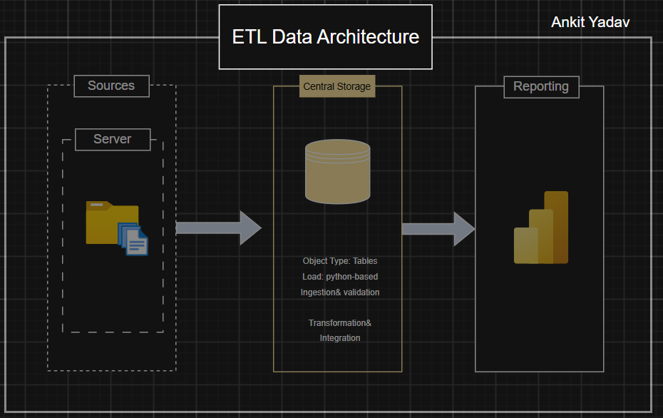
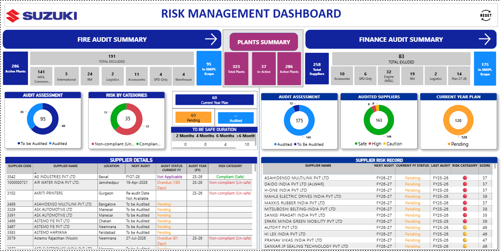
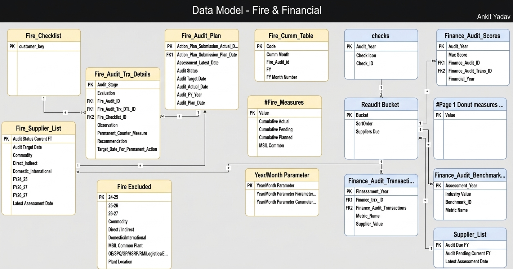

# Supplier Fire Risk Management & Audit Analytics

Welcome to the **Supplier Fire Risk Management & Audit Analytics** project! 🚀

This project demonstrates an end-to-end business intelligence solution developed to digitize the supplier fire risk audit process. It integrates Python-based data ingestion, SQL Server database management, Power BI dashboards, and workflow automation to provide management with a centralized view of audit execution, supplier compliance, and risk status.

---

## 🏗️ Solution Architecture

The solution connects data collection, storage, analytics, and reporting into a structured workflow.

**Workflow:**

Excel Audit Templates → Python Data Ingestion → SQL Server → Power BI → Management Reporting

- **Data Ingestion:** Developed a Python-based application to ingest audit information from Excel templates.
- **Data Storage:** Centralized audit data in Microsoft SQL Server for structured storage and analysis.
- **Data Modeling:** Organized audit plans, suppliers, checklist items, and audit transactions to support reporting requirements.
- **Analytics & Visualization:** Built Power BI dashboards to monitor audit progress, supplier compliance, and risk status.
- **Workflow Automation:** Used Power Automate to support report generation and export workflows.

---

## 📖 Project Overview

The project focuses on transforming a manual supplier fire risk audit process into a structured, data-driven reporting solution.

### Key Components

1. **Process Digitization:** Developed a structured workflow for collecting and consolidating supplier audit information.
2. **Python-Based Ingestion:** Built an application to ingest data from standardized Excel audit templates.
3. **SQL Server Database:** Designed a centralized data structure to organize audit plans, supplier information, and audit results.
4. **Power BI Dashboard:** Created management dashboards to track planned versus actual audits, pending audits, and supplier compliance.
5. **Reporting Automation:** Implemented a Power Automate workflow to support report export and distribution processes.

---

## 🎯 Business Objectives

The solution was designed to help management:

- Monitor planned versus completed fire risk audits.
- Identify audits that are pending completion.
- Track supplier compliance and non-compliance.
- Review audit performance across suppliers and reporting periods.
- Improve visibility into the overall audit execution process.
- Access structured reporting to support risk monitoring and management decisions.

---

## 📊 Dashboard & Analytics

The Power BI dashboard provides a consolidated view of supplier fire risk audit performance.

### Key Metrics and Features

- **Audit Plan vs. Actual:** Compare planned audits with completed audits.
- **Pending Audits:** Identify audits that are yet to be completed.
- **Compliance Monitoring:** Track compliant and non-compliant audit outcomes.
- **Supplier-Level Analysis:** Review audit status and results across suppliers.
- **Time-Based Analysis:** Monitor audit execution across reporting periods and financial years.
- **Management Reporting:** Present key performance indicators and audit information in a centralized dashboard.

*Note: Dashboard screenshots do not contain any sensitive information and is approved for public sharing.*

---

## 🗄️ Data Model

The database structure organizes the information required for audit planning, execution, and reporting.

### Main Data Entities

- **Fire Audit Plan:** Stores audit planning information and planned audit schedules.
- **Supplier List:** Maintains supplier-related information used in audit tracking.
- **Fire Audit Transactions:** Records audit-level information and execution status.
- **Fire Audit Transaction Details:** Stores detailed audit checklist responses and results.
- **Fire Checklist:** Defines the checklist items used to assess fire risk compliance.
- **Date Dimension:** Supports financial-year, monthly, and period-based analysis.

The data model supports the relationship between audit planning, supplier information, audit execution, and detailed checklist results, enabling consistent reporting in Power BI.

---

## 🛠️ Technology Stack

| Technology | Purpose |
|---|---|
| Python | Excel template ingestion and data processing |
| Microsoft SQL Server | Centralized data storage and querying |
| Power BI | Dashboard development and business intelligence |
| DAX | Measures and analytical calculations |
| Power Query | Data transformation and preparation |
| Power Automate | Reporting and export workflow automation |
| Microsoft Excel | Source templates for audit data collection |

---

## 💼 My Contribution

Independently developed the end-to-end analytics solution, covering data ingestion, database design, Power BI dashboard development, and reporting workflow automation.

The project combined data engineering and business intelligence to translate an operational audit process into a structured reporting solution for management.

---

## 🌟 About Me

Hi, I'm **Ankit Yadav**, a postgraduate in Data & Business Analytics from Rennes School of Business, France.

My interests include data analytics, business intelligence, process automation, and using data to support strategic and operational decision-making.

Let's connect:

- **LinkedIn:** [Ankit Yadav](https://www.linkedin.com/in/ankityadavbiz/)

---
